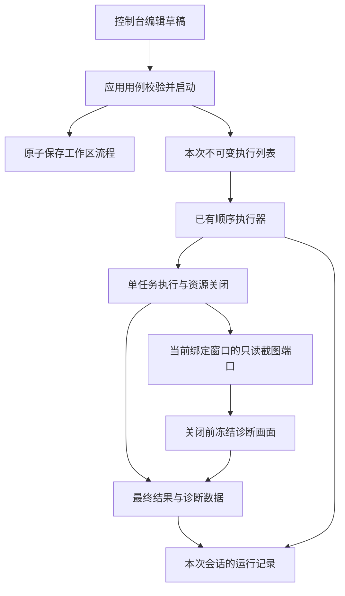

# 0019 可编辑任务编排与运行记录

- 状态为 accepted
- 日期为 2026-11-17，用户要求自行选择和排序任务、重复执行同一任务，并在失败中断时保存日志和窗口画面
- 扩展 [ADR 0017](0017-saved-task-plans.md) 的保存流程

## 使用方式

用户在控制台开启编排列表，左侧选择已有脚本，右侧显示执行顺序。两列的每个条目只占一行。选中右侧条目后，通过下方控件排序、移除和设置完成后等待。相同任务可以多次添加。例如切换角色甲、日常任务、切换角色乙、日常任务。保存保留当前列表，运行保存并执行点击时提交的完整列表。

每次桌面单任务或流程运行在工作区 `.star/runs/` 下创建独立记录目录。记录包含完整输出、最终结果、各条目的执行结果，以及中断时可取得的目标窗口图片。控制台提供打开记录文件夹的入口。

## 所有权

| 数据 | 所有者 | 身份与生命周期 |
| --- | --- | --- |
| 编辑草稿 | 原生会话 | UUID 区分每次添加，允许同名项独立排序和删除 |
| 已保存流程 | 工作区配置用例 | 有序数组保存任务名与等待时长，沿用现有 JSON 格式 |
| 执行列表 | 后台运行会话 | 启动时解析为不可变元组，本次序号区分重复任务 |
| 窗口与采集源 | 原生运行会话 | 单项任务打开和关闭，始终使用已绑定窗口 |
| 诊断图片 | 单任务结果 | 关闭前编码为独立 PNG 数据，调用方无须读取已关闭端口 |
| 日志与摘要 | 本次运行归档 | 独立目录，完整磁盘文本与有界界面缓冲分别保存 |

启动用例在同一运行锁内校验所有引用、准备任务依赖、保存配置并创建执行快照。界面只提交一次启动请求。运行过程中更改磁盘配置不会改变本次列表。运行时保存和另一次启动沿用唯一运行槽的互斥规则。

刷新任务目录保留用户尚未保存的草稿。顺序展示从草稿派生，避免另存一份可能过期的摘要。

## 中断与诊断

单任务执行器负责异常归一化和窗口关闭，因此也负责诊断图片的采集时机。桌面入口启用诊断后，执行器在关闭源之前暂存候选 PNG。关闭后确定最终结果，正常完成和明确跳过丢弃候选，其他结果返回图片或具体采集错误。清理失败及清理期间收到取消，也能使用关闭前的候选画面。

平台端口对首次尚无画面和过期画面做短有界等待，总计约一秒。读取保持当前窗口身份，期间只采集画面。初始化尚未绑定窗口、窗口丢失、采集权限不可用、模拟运行和任务间等待取消，都可能无法取得截图，记录说明具体原因。

归档在窗口资源回收之后消费结果值，保存异常堆栈、条目序号和图片。PNG 单独保存，跨进程状态只传文本和记录路径。图片和堆栈供事后排查，不参与后续任务的执行判断。

归档模块集中处理存储错误，并向控制台提供警告。日志或图片写入故障保持原任务的退出结果。文本逐次追加，摘要通过临时文件原子替换。进程强退后保留已经写出的文件，缺少结束时间的记录表示尚未确认结束。

## 综合选择与代价

采用会话拥有归档、单任务返回不可变诊断结果的结构。两次独立设计比较均选择该结构。执行器直接创建归档的候选会让它同时承担工作区路径、流程序号和整轮日志策略。外层回调读取活跃端口的候选则要求调用方协调源的关闭时机。

这一选择按 Model the Domain 将重复项建模为有序条目，将单项诊断建模为结果值。按 Laziness Protocol 复用现有计划执行器、配置格式和运行槽，收拢保存启动操作，移除动态字符串记录调度和冗余摘要。

- 接受每项真实任务关闭前临时采集一帧的开销，以覆盖清理阶段才确定的失败。成功时只保留日志和结果。
- 接受目标不可采集时留下明确缺图原因，保留原始失败信息。
- 每个工作区保存一套列表。记录覆盖控制台单任务和整套流程，CLI 持久归档另按实际需求接入。
- 保留现有停止规则。普通失败和条件未满足终止后续项，明确跳过继续，用户取消终止整轮。
- 记录持续保存在本地，容量管理和可视历史检索在实际记录量需要时评估。

## 重审条件

反复出现多套列表切换、跨工作区编排、历史检索困难、诊断采集延迟或记录容量问题时，针对实际证据扩展相应边界。

## 验证

验收覆盖规则和存储替身、独立工作区原生界面，以及自有测试窗口的实际失败截图。验证结果维护在 [当前状态](../current-state.md)。
