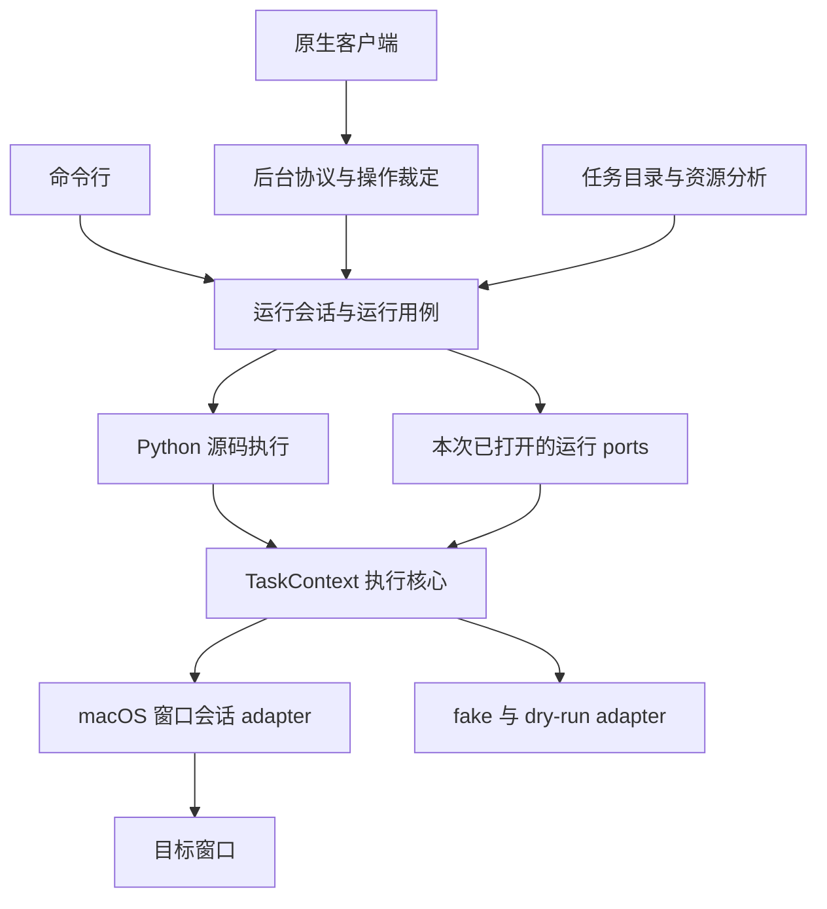

# 核心优先的执行架构

本设计落实 2026-11-14 用户提出的整体架构调整。先独立验证执行核心，再逐步接入任务格式、工作区、运行会话、平台与原生客户端。

## 目标结构

准备会话和窗口观察分别持有自己的资源与生命周期，由后台协议协调操作许可。

## 执行核心

`TaskContext` 直接持有当前窗口、命名资源、已打开的能力、有效任务时钟、取消信号与事件记录。定位、输入、等待、期限和操作结果在同一 module 中维护。

任务作者继续使用同步 `run(ctx)`。普通 Python 承担业务分支、函数调用与局部恢复。核心接收纯目标与查询值，任务作者用 Python 控制流组织执行。

核心自己拥有操作编号和作用域编号。一次成功动作保持自己的成功结果，随后代码段到期时，由对应作用域产生期限事件。嵌套期限保留实际到期作用域，局部恢复只处理自己拥有的到期结果。

输入准备复用当前 `RuntimeControl.execute_input`。恢复后重新定位尚未提交的输入，已提交输入继续完成必要释放。窗口身份、新帧证明、平台暂停记账与关闭故障租约由平台会话拥有。

## 任务目录与资源分析

任务目录拥有 Python 文件枚举、读取、排序、错误隔离和名称去重。发现与详情通过 AST 读取静态元信息。遗留 JSON 任务显示迁移诊断。

资源依赖、能力需求和详情消费同一次任务分析产出的事实。任务从资源声明获得这些事实。文件系统检查属于外围实现。

目标和资源声明的解析具有自己的归属。任务解析复用这些知识，配置 JSON 独立保存素材与状态规则。

## 运行与平台会话

应用用例负责环境准备、打开运行能力、调用任务、关闭资源与汇总结果。一次原生窗口会话返回的能力按同一集合交给核心使用。

后台运行会话拥有线程、取消标记、日志缓冲和实际终态。重复停止表达同一次停止意图，资源结束之前继续占用运行位置。执行错误和清理错误均保留。

平台 adapter 处理系统输入、截图、固定窗口、新帧和恢复。核心通过同一 seam 使用真实、模拟和 fake 能力。

## 原生客户端

客户端分别记录实际运行占用和用户停止意图。停止中的运行继续等待结束，其显示状态具有稳定含义。用户明确请求重启时，进入已有的关闭、退出确认和新代次启动流程。随后到达的退出请求撤销待重启意图，退出完成时保持后台已结束。

原生会话拥有操作可用性的推导，视图消费这些结果。后台在实际请求处继续裁定互斥，旧响应无法发布到新工作区代次。

## 方案比较

| 方案 | interface 的负担 | 采用的部分 |
| --- | --- | --- |
| 单个执行入口与上下文 | 框架学习 callable、绑定数据和执行结果 | 通用作用域、单一规则所有权、已有 adapter seam |
| 命令和结果推进 | 维护命令、请求、回复、续态和 driver | 操作结果与作用域身份分离 |
| 直接运行上下文 | 作者和行为测试使用同一组方法 | 作为本轮核心形状，集中动作及控制规则 |

本轮沿用 `TaskContext` 名称作为直接执行 module 的作者 interface。其 depth 来自对定位、期限、取消与事件的集中处理。任务与核心行为测试调用同一接口，执行规则集中在一处。

## 验证顺序

1. 先固定当前完整测试基线和工作树快照。
2. 用 fake 输入、识图、状态、时钟、取消和事件独立验证核心。
3. 逐任务迁移为直接 Python 控制流，核对循环退出、缺图、超时和连续输入。
4. 接任务分析与发现，核对依赖和能力一致、坏文件隔离、源码快照。
5. 接 CLI、后台协议与原生窗口 factory，核对同次打开关闭及取消后再次运行。
6. 编译实际 Swift 会话代码，用受控后台验证停止、重复停止、重启和旧代次。
7. 运行完整回归与差异检查，按实际平台接入变化安排必要 smoke。

真实桌面效果与业务任务完成分别记录。任务工作区中的业务流程逐个迁移，每个流程都以目标应用的证据验收。

## 删除顺序

本轮移除上下文对共享动作对象的透传、执行核心对旧步骤树控制规则的依赖，以及资源分析和目录隔离中的重复实现。

本地活动任务和通用示例统一迁移为 Python 函数，同时移除旧控制节点、条件对象、解释器、JSON 任务语法解析、步骤树分析与旧示例注册。资源配置及平台会话各自继续承担原有职责。迁移结果和行为取舍见 [ADR 0015](../adr/0015-python-only-tasks.md)。
